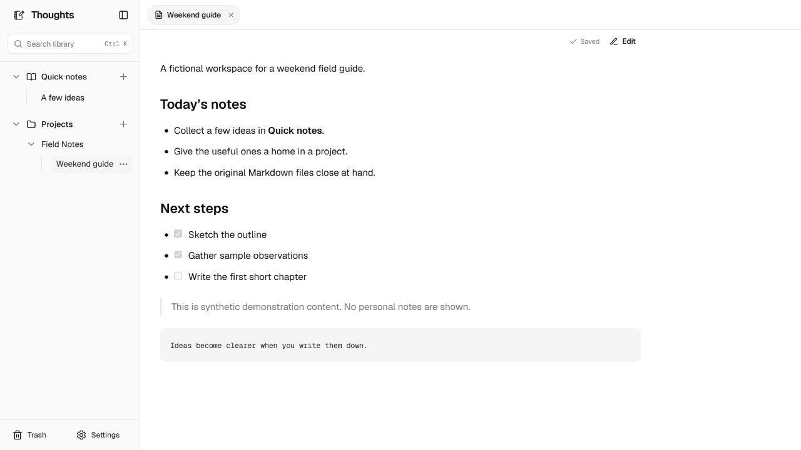

[English](README.md) | [简体中文](README.zh-CN.md) | [繁體中文](README.zh-TW.md) | [日本語](README.ja.md) | [한국어](README.ko.md) | [Deutsch](README.de.md) | [Français](README.fr.md) | [Español](README.es.md)

# Thoughts

[Install](INSTALL.md) · [Documentation](docs/README.md) · [Donate](DONATE.md) · [Code signing policy](docs/CODE_SIGNING_POLICY.md)

Free, open-source, local-first notes for Windows x64. Let your AI assistant manage Markdown files and read them in an independent local webpage.

**Unsigned preview — 2026-11-04:** `0.3.0-preview.21` standardizes the source, executable and client configuration names as Thoughts. The maintainer has authorized an **unsigned experimental prerelease** at [GitHub Releases](https://github.com/xuli82221-pixel/hello-Thoughts-/releases/tag/v0.3.0-preview.21); the assets are now available after a successful public Windows build and checks. **No trusted publisher signature or stable-release acceptance is claimed.** SignPath Foundation approval is pending. Windows SAC/SmartScreen may block it; stop if blocked and keep protection enabled. See [release readiness](docs/RELEASE_READINESS_20261104.md), [installation](INSTALL.md) and [earlier native Windows tests](docs/WINDOWS_NATIVE_TESTS_20261104.md).

## Your notes, on your computer

Thoughts has no account, cloud database, note upload service, telemetry, built-in AI, paid theme, subscription, payment integration or browser extension. Markdown and local images belong to you and can be opened in other editors.

The Go executable embeds the React webpage. **Precompiled releases need no Node.js, Go, Python or Docker at runtime.** Your chosen AI client has its own installation/account requirements.

## Downloads and installation

This experimental preview offers **`thoughts-<version>-windows-amd64-setup.exe`**, a portable ZIP and a Claude Desktop MCPB through [GitHub Releases](https://github.com/xuli82221-pixel/hello-Thoughts-/releases). The program inside is **`thoughts.exe`**. Verify SHA256 before use; the current files have **no Authenticode signature**. Do not treat a matching hash as publisher authentication. Windows may refuse to run them; stop if blocked. Setup is per-user, initializes the shared home and creates desktop/Start-menu shortcuts without administrator privileges. Existing data is retained; uninstall removes launchers/shortcuts and retains the shared home for other clients. Signed stable packages remain pending.

Claude Desktop users can instead import the release's `.mcpb` extension. Codex and Claude Code users register the executable from the ZIP as a local stdio MCP server. The webpage can also run without an AI client. Follow the [end-user quick start](INSTALL.md#ordinary-windows-users) for the supported commands. GitHub's **Code → Download ZIP** downloads source code, not the precompiled application.

AI clients start the same local stdio MCP adapter. It calls the authenticated local core, whose webpage listens only on `127.0.0.1`. When you ask an online AI client to read a note, that client receives its contents under its own data policies. Local-first does not mean requested AI tool results never leave the computer. Files are not encrypted by Thoughts.

## Target clients

| Client | Installation |
| --- | --- |
| Claude Desktop | Official `.mcpb` extension format |
| Claude Code on Windows | Local stdio MCP, portable Windows ZIP |
| OpenAI Codex on Windows | Local stdio MCP, the same portable ZIP |

These are target integrations; actual acceptance status is in the release review. Ordinary ChatGPT web plugins, macOS, Linux, mobile, remote MCP and cloud sync are outside this phase.

## Features

- Local Markdown creation, reading, editing, search, rename and move.
- Compact project tree, Quick notes, project archive/unarchive and recoverable note/project Trash.
- Existing notes open in rendered preview; editing is explicit.
- Local PNG/JPEG/WebP images, preview and lightbox.
- Free themes and validated local theme imports.
- English, Korean, Japanese, Simplified Chinese, Traditional Chinese, German, French and Spanish UI, with matching local privacy/use notices.
- External file change notifications and SHA256 conflict protection.
- One explicitly configured library for all clients; repeat initialization preserves the existing selection.
- Checksum-verified local core upgrades and software rollback, with unsaved-editor protection.
- Server-saved note tabs and reading positions that survive a service port change.

Conflict protection rejects stale writes; automatic revision history is not implemented. Back up your library separately. An open tab can retain a draft during a conflict/disconnection; draft recovery after closing it or restarting Windows is not guaranteed.



Actual `0.3.0-preview.20` UI, captured on 2026-11-04 in a new isolated temporary library with fictional notes. No personal notes, real images, local machine paths or credentials are shown. The [earlier-layout screenshot](docs/assets/preview.png) is preserved as historical material, not presented as the current version. Screenshot verification is not installer or client acceptance.

## Install

See [INSTALL.md](INSTALL.md) for SHA256 checks, inspect-first commands and all three clients. New preview.8 installations default to the same Windows-user Thoughts directory in every client, regardless of installation order. Keep the advanced home setting on `auto`. An explicit absolute `THOUGHTS_HOME` is only needed for a deliberately customized home:

```text
<Thoughts home>/
  library/     Markdown, images and recoverable Trash
  config/      Configuration, local sessions, preferences and logs
  app/         Managed executable versions (optional)
  backups/     Previous runtime pins; not a backup of note bodies
```

Use the shared default for normal installations. The legacy configuration override remains available; this release does not automatically migrate or merge an existing library. If deliberately customizing the home, use the same physical folder across the clients that should share it.

Installations and updates must retain this home. Reading state stores paths and scroll positions, not unsaved text. Core updates currently require an explicitly supplied, reviewed local executable and SHA256; there is no background network updater. Updating a client extension and updating the shared core are separate steps. See the [upgrade instructions](INSTALL.md#managed-core-updates-and-rollback).

Unsigned Windows programs or scripts may be blocked by SmartScreen, Smart App Control or organizational application-control policy. SHA256 proves integrity against a checksum, not publisher identity. Never disable protection or bypass warnings to run a preview. Open-sourcing does not solve signing.

## Workspace

See [workspace layout](docs/WORKSPACE_LAYOUT.md) and the [documentation index](docs/README.md). Old requirements/reports are preserved in a local archive. Current source and executable names use Thoughts. Legacy data identifiers are retained for compatibility.

## Build

Build dependencies: Windows x64, Go matching go.mod, Node.js 24, Python 3.12+ and the signed official [Inno Setup 7 compiler](https://jrsoftware.org/isdl.php). End users need none of them. See [CONTRIBUTING.md](CONTRIBUTING.md).

```powershell
Set-Location web
npm ci
Set-Location ..
pwsh -File scripts/build-desktop-adapters.ps1 -Python 'C:\Tools\Python\python.exe' -Go 'C:\Tools\Go\bin\go.exe' -InnoCompiler 'C:\Tools\InnoSetup7\ISCC.exe'
```

Replace tool paths with your installed tools. The build tests/builds the frontend and Go core, generates notices, creates Setup.exe/ZIP/MCPB plus checksums, and validates the packages in a new output directory. Existing output is never overwritten. No upload happens automatically. Public-candidate mode requires trusted signatures and real publisher metadata; signing does not attest clean-machine or client acceptance.

## Security and license

See [SECURITY.md](SECURITY.md), [PRIVACY.md](PRIVACY.md), [CHANGELOG.md](CHANGELOG.md), [third-party notices](THIRD_PARTY_NOTICES.txt) and [dependency review](docs/DEPENDENCIES.md). Project code is MIT licensed; bundled dependencies retain their own licenses, including OFL fonts.

Never commit real notes, personal screenshots, credentials, session files or logs. Report vulnerabilities privately to hello@spxipo.com. Settings offers optional sponsorship using the owner's Base mainnet address. The QR contains only the address; select Base explicitly in your wallet. Thoughts does not connect wallets, request private keys, select an asset/amount, or process payments. All features remain free.

## Code signing policy

**Pending — SignPath Foundation application not yet approved.** All current Windows programs remain unsigned. If approved, free code signing provided by SignPath.io, certificate by SignPath Foundation. See the [Code signing policy](docs/CODE_SIGNING_POLICY.md) and [application preparation](docs/SIGNPATH_APPLICATION.md) for scope, real team roles and outstanding requirements. No application has been submitted by this preparation.

## Donate

Support is voluntary and unlocks no features. See the dedicated [Donate page](DONATE.md) for the maintainer's existing Base address, address-only QR and privacy boundaries. You can also help through issues, translations and documentation. There is no wallet connection or payment processing in Thoughts.
